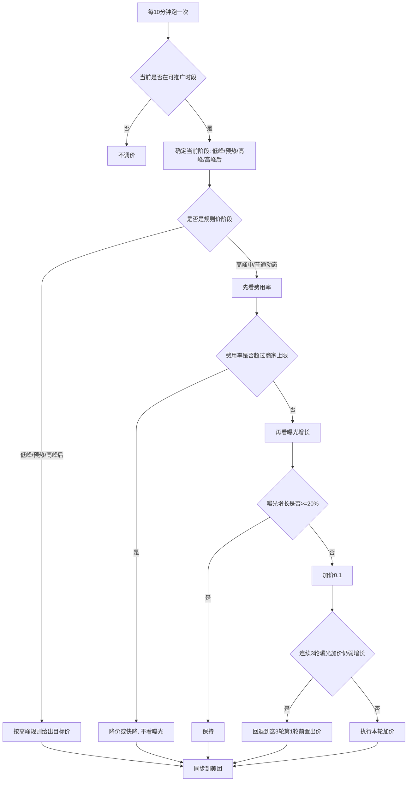
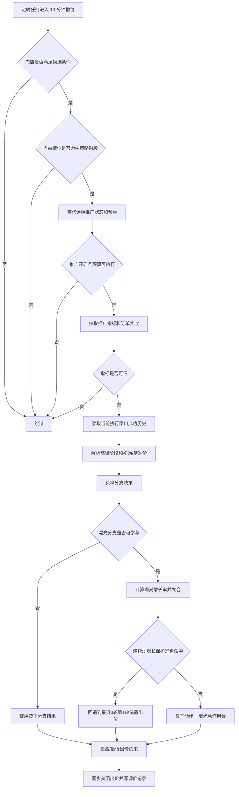

# 核心出价算法说明

本文档说明当前后端自动调价链路的核心出价规则，给运营、产品、研发和排障同学统一口径使用。当前实现以 10 分钟为一个执行槽位，后端在每个槽位为符合条件的门店计算下一时段推广出价，并同步到美团推广计划。

## 1. 运营版算法总览

可以先把当前算法理解成一句话：

> 系统每 10 分钟看一次门店推广效果，先保证费用率不要超商家设置的上限，再看曝光增长是否够；高峰前会提前加价预热，高峰后会按单量情况逐步降回低峰价。

核心过程如下：



几个运营侧最重要的判断：

| 问题 | 当前真实规则 |
| --- | --- |
| 多久调一次价 | 每 10 分钟 |
| 第一次多少钱 | 优先按附近商家平均出价折算；不可用时默认 `0.40` 元；最低不能低于 `0.10` 元 |
| 费用率怎么算 | `窗口推广花费 / 窗口实收`；有花费但实收为 0 时，费用率按 `100%` 处理 |
| 商家设置的最低费率会强制参与调价吗 | 当前不会。系统主要控制最高费率 `rateMax`，低于最低费率不会自动触发特殊降价或加价 |
| 费用率超上限还会因为曝光少而加价吗 | 不会。费用率超过商家设置的最高费率时，曝光分支直接跳过 |
| 曝光增长多少算有效 | 最近两次调价后 10 分钟曝光增长率 `>= 20%` 算有效 |
| 曝光没涨会一直加价吗 | 不会。连续 3 轮因曝光弱增长加价后，如果仍低于 20%，会回退到这 3 轮第 1 轮的前置出价 |
| 高峰前怎么预热 | 高峰前最多 40 分钟开始，每 10 分钟加 `0.10`；但必须已经在营业/执行时段内 |
| 高峰后怎么降 | 普通门店每轮降 `0.10`，近 7 日日均单量 `>=30` 时每轮可快降 `0.20`，不低于低峰基准 |
| 曝光优先是否不管费率 | 不是。曝光优先只是不触发“超过上限 5 个百分点快降 0.20”，但超过最高费率仍会降价并跳过曝光 |

## 2. 对运营版 11 条理解的校正

下面按运营同学整理的 11 条逐条校正。每条先列出原文，再说明当前系统的真实口径、关键分支和典型示例。

### 2.1 高峰期先调商圈平均出价，获取出价参考

原文：

> 高峰期先调商圈平均出价：获取出价参考

校正结论：口径基本一致，但商圈均价只在需要确定参考价时使用，不是每一轮高峰都重新查询并覆盖当前出价。

核心逻辑：

- 当前窗口没有可继承的成功历史、基准价或高峰入场价时，系统会尝试查询附近商家平均出价。
- 附近均价查询成功且数值在有效范围内时，用附近均价折算初始参考价。
- 附近均价查询失败、为空或超出有效范围时，继续使用兜底来源，例如当前美团计划价、历史基准价或默认初始价。
- 同一个高峰窗口内已经形成过高峰入场参考后，后续 10 分钟轮次优先沿用窗口内历史，不会每轮重新用附近均价覆盖。

示例：

门店今天 12:00-13:00 是午高峰。12:00 第一次进入这个高峰窗口时，如果系统此前没有记录过本窗口的高峰入场参考价，就会查询附近商家平均出价。若附近均价可用，则折算出本次高峰的初始参考价；若不可用，则回退到其他来源。

同一高峰窗口内，12:00 已经成功计算过一次后，12:10 继续执行时会优先继承当前窗口已经形成的高峰入场参考，不会再把附近均价当作新的强制覆盖价。

低峰基准价也有类似逻辑。系统需要确定低峰底价时，也可能参考附近均价；如果附近均价不可用，再回退到历史基准、当前计划价或默认价。

### 2.2 首次出价公式：`(商圈均价 - 0.7) * 50% - 0.1`

原文：

> 以商圈平均出价50%-0.1元为首次出价（调整后：商圈-0.7的50%-0.1元为首次出价）

校正结论：口径一致，当前实现使用调整后的公式。

当前实际公式是：

```text
首次参考价 = (附近商家平均出价 - 0.70) * 0.50 - 0.10
```

核心逻辑：

- 公式中的“附近商家平均出价”必须在 `0.10-1.50` 元范围内，超出范围不采用。
- 公式结果会向下取到“角”。
- 最终出价不能低于系统最低价 `0.10` 元。
- 附近均价不可用时，不会阻塞调价，会进入兜底来源。

示例 1：附近均价为 `1.50` 元。

```text
(1.50 - 0.70) * 0.50 - 0.10 = 0.30
```

初始参考价为 `0.30` 元。

示例 2：附近均价为 `1.00` 元。

```text
(1.00 - 0.70) * 0.50 - 0.10 = 0.05
```

低于系统最低价，最终会按 `0.10` 元执行。

示例 3：附近均价接口失败或返回值不可用。系统继续使用默认初始价 `0.40` 元，或在中途开启场景使用当前美团计划价。

### 2.3 每 10 分钟获取曝光、花费、营收并计算费率

原文：

> 10分钟获取一次效果接口：曝光量、花费、营收（计算费率=（花费/营收）*100%，费率控制在变量X%值内，比如：5%-10%之间，由商家配置觉得变量X%

校正结论：口径基本一致，但费用率使用的是当前执行窗口累计口径，不是简单的最近 10 分钟口径。

核心逻辑：

- 系统每 10 分钟执行一次调价判断。
- 指标包括曝光、推广花费、订单实收。
- 窗口费用率 = 当前执行窗口累计推广花费 / 当前执行窗口累计订单实收。
- 当前 10 分钟花费增量会单独计算，用于判断本槽位是否有新增点击消耗。
- 曝光增长不是直接看累计曝光，而是比较最近两次成功出价后各自 10 分钟内的曝光增量。

例如营业窗口是 10:00-22:00，现在是 11:00：

```text
窗口推广花费 = 10:00 到 11:00 的推广花费
窗口实收 = 10:00 到 11:00 的订单实收
窗口费用率 = 窗口推广花费 / 窗口实收
```

### 2.4 分析前 2 次出价后数据：花费是否增加，费率是否下降

原文：

> 分析前2次出价后数据：花费是否增加，费率是否下降（出价逻辑：①如花费未增加且费率小于X%,当前竞价A+0.1元出价。②如花费增加且费率小于X%，保持当前竞价A不变。③如花费增加且费率大于X%，当前竞价A-0.1元出价。④如花费未增加且费率大于X%，当前竞价A-0.1元出价。）

校正结论：口径需要修正。当前系统不会判断“费率是否比上一次下降”，主要判断当前窗口费用率是否超过商家配置的最高费率，以及当前 10 分钟是否有新增推广花费。

核心逻辑：

- 当前窗口费用率超过最高费率 `rateMax`：优先降价。
- 当前窗口费用率没有超过最高费率，且当前 10 分钟没有新增推广花费：倾向加价 `0.10`，用于试探是否能获得点击。
- 当前窗口费用率没有超过最高费率，且当前 10 分钟有新增推广花费：倾向保持，避免在已经有点击消耗时继续盲目加价。
- 商家配置的最低费率 `rateMin` 当前不会触发硬性动作。

示例：

商家配置费率范围为 `5%-10%`。

- 当前费用率 `12%`：超过最高费率，系统降价。
- 当前费用率 `8%`，本槽位无新增推广花费：系统可能加价 `0.10`。
- 当前费用率 `8%`，本槽位有新增推广花费：系统保持。
- 当前费用率 `3%`：低于最低费率 `5%` 本身不会触发强制加价，仍需结合花费增量和曝光增长判断。

### 2.5 曝光增长是否有效：`>=20%` 保持，`<20%` 加价，连续 3 轮保护

原文：

> 分析前2次出价后数据：曝光量是否有效增加（费用率小于等于商家设置变量X%以内时=出价逻辑：①第2次出价后10分钟的曝光量比前1次出价后10分钟的曝光量增长率＞=20%即判断有效果，当前竞价A不变。②如曝光增长率小于20%，当前竞价A+0.1元出价，连续加价3轮，曝光增长率依然小于20%，暂停加价，以前3轮第1轮出价作为新出价。）

校正结论：口径基本一致，补充两个关键前提：曝光分支只在费用率未超过最高费率时参与；连续 3 轮保护回退的是这 3 轮第 1 轮加价前的出价。

核心逻辑：

- 取最近两次成功出价记录。
- 分别计算每次出价后 10 分钟内的曝光增量。
- 曝光增长率 `>=20%`：曝光分支建议保持。
- 曝光增长率 `<20%`：曝光分支建议加价 `0.10`。
- 当前费用率超过最高费率时，曝光分支跳过，不参与加价。
- 连续 3 轮都是曝光弱增长导致的加价，且当前仍然 `<20%`，系统停止继续加价，回退到这 3 轮第 1 轮加价前的出价。

第 1 次出价后 10 分钟新增曝光是 `100`，第 2 次出价后 10 分钟新增曝光是 `125`：

```text
曝光增长率 = (125 - 100) / 100 = 25%
```

因为 `25% >= 20%`，系统认为曝光增长有效，本轮曝光分支建议保持。

如果第 2 次只有 `115`：

```text
曝光增长率 = (115 - 100) / 100 = 15%
```

因为 `<20%`，系统认为曝光增长不够，本轮曝光分支建议加价 `0.10`。

连续弱增长保护示例：

```text
0.40 -> 0.50
0.50 -> 0.60
0.60 -> 0.70
下一轮仍然曝光弱增长，则回退到 0.40
```

### 2.6 最终出价：费用率和曝光合并，超费用率时剔除曝光

原文：

> 最终出价：费用率阈值内（判断4+5条件出价，如4+5条件=0.2最终出价+0.1，如4条件+0.1与5条件-0.1最终出价+0），超费用率阀值（剔除5条件，只考虑4条件）

校正结论：口径基本一致。费用率没有超过最高费率时，费率分支和曝光分支会合并；费用率超过最高费率时，只采用费率分支。

核心逻辑：

- 费率分支输出动作：降价、保持、加价。
- 曝光分支输出动作：保持、加价，或不参与。
- 合并后单轮最多加 `0.10`，最多减 `0.10`。
- 费用率超过最高费率时，曝光分支直接跳过。

示例：

- 费率分支建议加 `0.10`，曝光分支也建议加 `0.10`：最终只加 `0.10`，不会加 `0.20`。
- 费率分支建议保持，曝光分支建议加 `0.10`：最终加 `0.10`。
- 费用率超过最高费率，曝光增长又不足：最终仍按费用率降价，曝光分支不参与。

### 2.7 高峰前 40 分钟开始，每 10 分钟加 `0.10`

原文：

> 高峰期出价节点设置在高峰期前40分钟开始，每10分钟+0.1元

校正结论：口径基本一致，但预热必须发生在可执行时段内。未营业或未命中自定义执行时段时，不会提前预热。

核心逻辑：

- 高峰前最多 40 分钟进入预热。
- 每 10 分钟在低峰基准价基础上加 `0.10`。
- 预热最多加 4 个槽位，即最高低峰基准价 + `0.40`。
- 当前槽位必须在门店营业时间或策略自定义执行时段内。
- 如果高峰开始时间早于营业开始时间，营业开始前的预热槽位不会执行。

例如低峰基准是 `0.40`，高峰 12:00 开始：

```text
11:20 -> 0.50
11:30 -> 0.60
11:40 -> 0.70
11:50 -> 0.80
12:00 -> 进入高峰动态定价
```

例如门店 10:00 才营业，高峰也 10:00 开始。虽然 09:50 距离高峰只有 10 分钟，但 09:50 不营业，系统不会调价，所以不会预热。10:00 一到，已经是高峰开始，系统直接进入高峰动态定价。

如果门店 10:00 营业，高峰 10:10 开始，那么 10:00 已经营业，距离高峰 1 个槽位，会有一轮预热。

### 2.8 近 7 日日均单量 `>=30`，低峰期降价 `-0.20` 一轮

原文：

> 每近7天日周期，日均单量＞=30单，低峰期降价-0.2一轮

校正结论：口径基本一致，但作用场景更准确地说是高峰后回落，不是所有低峰时段都固定降 `0.20`。

核心逻辑：

- 当前阶段需要处于高峰后回落。
- 当前出价必须高于低峰基准价。
- 近 7 日日均单量 `>=30` 时，每轮最多降 `0.20`。
- 降价不会低于低峰基准价。

示例：

高峰结束时出价是 `0.90`，低峰基准价是 `0.40`，门店近 7 日日均单量 `>=30`：

```text
高峰后一轮：0.90 -> 0.70
再后一轮：0.70 -> 0.50
再后一轮：0.50 -> 0.40
```

最终不会低于低峰基准价。

### 2.9 近 7 日日均单量 `<30`，低峰期降价 `-0.10` 一轮

原文：

> 每近7日周期，日均单量＜30单，低峰期降价-0.1一轮

校正结论：口径基本一致，同样属于高峰后回落规则。

核心逻辑：

- 当前阶段需要处于高峰后回落。
- 当前出价必须高于低峰基准价。
- 近 7 日日均单量 `<30` 时，每轮最多降 `0.10`。
- 降价不会低于低峰基准价。

示例：

高峰结束时出价是 `0.90`，低峰基准价是 `0.40`，门店近 7 日日均单量 `<30`：

```text
高峰后一轮：0.90 -> 0.80
再后一轮：0.80 -> 0.70
再后一轮：0.70 -> 0.60
再后一轮：0.60 -> 0.50
再后一轮：0.50 -> 0.40
```

系统逐步降回低峰基准，不会无限降低。

### 2.10 低峰期订单占比 x%，逐步减价至高峰最后一次出价 a 的 x%

原文：

> 低峰期订单占比x%，逐步减价（以8和9规则）至高峰期最后一次出价a的x%出价为底价

校正结论：口径需要修正。低峰订单占比会影响低峰基准价，但不是无条件把低峰底价设置为“高峰最后一次出价 * x%”。

核心逻辑：

- 系统会计算低峰占比参考价。
- 低峰占比参考价 = 最近高峰出价 * 低峰订单占比。
- 该参考价主要用于抬高低峰基准，避免低峰有订单价值的门店被降得过低。
- 如果低峰占比参考价低于现有低峰基准，通常不会把低峰基准往下拉。

```text
低峰占比参考价 = 最近高峰出价 * 低峰订单占比
```

示例：

最近高峰出价是 `1.00`，低峰订单占比是 `40%`：

```text
低峰占比参考价 = 1.00 * 40% = 0.40
```

如果原低峰基准是 `0.30`，系统可能把低峰基准抬到 `0.40`。高峰后回落时，会逐步降到 `0.40`，而不是继续降到 `0.30`。

如果原低峰基准本来就是 `0.50`，那 `0.40` 不会把它拉低，系统仍以 `0.50` 作为低峰基准。

因此，准确口径是“低峰订单占比会影响低峰底价”，不是“固定降到高峰价的 x%”。

### 2.11 当前费率超出 max+5% 时，出价 -0.20，直到回到 x%，再开始主算法；曝光优先不考虑 11

原文：

> 当前费率%超出商家设置max费率X%+5%时，减价策略出价-0.2，直至费率调到商家设置x%，再开始±0.1主算法逻辑（选择曝光优先不考虑11条件）

校正结论：口径需要修正。`max + 5 个百分点` 的快降只在“费率优先”策略下触发；“曝光优先”不触发快降，但仍然受最高费率约束。

核心逻辑：

- 商家选择 `priority = rate`，且当前费用率 `> rateMax + 5 个百分点`：本轮快降 `0.20`。
- 商家选择 `priority = exposure`，即使当前费用率 `> rateMax + 5 个百分点`，也不触发 `0.20` 快降。
- 只要当前费用率 `> rateMax`，无论是费率优先还是曝光优先，都会跳过曝光分支，避免继续加价。
- 系统不是进入一个长期“快降模式”，而是每 10 分钟重新判断一次。

例如商家最高费率设置为 `10%`：

```text
快降线 = 10% + 5% = 15%
```

如果当前费用率是 `16%`，且商家选择的是费率优先，那么本轮会降 `0.20`。

但如果商家选择的是曝光优先，当前费用率 `16%` 时不会走 `-0.20` 快降，而是走普通超费率降价，降 `0.10`。

后续轮次按实时状态重新判断：如果仍满足 `rateMax + 5 个百分点`，继续快降；如果已经不满足快降条件但仍超过最高费率，普通降 `0.10`；如果没有超过最高费率，回到主算法并允许曝光分支参与。

## 3. 核心参数速查

| 项目 | 当前规则 |
| --- | --- |
| 执行周期 | 每 10 分钟一个槽位 |
| 最低出价 | `0.10` 元 |
| 默认初始出价 | `0.40` 元 |
| 常规调价步长 | `0.10` 元 |
| 费率优先快降步长 | `0.20` 元 |
| 全局最高同步出价 | `4.00` 元 |
| 曝光增长有效阈值 | `>= 20%` 认为有效，保持；`< 20%` 认为弱增长，建议加价 |
| 连续弱增长保护 | 连续 3 轮因曝光弱增长加价后，当前仍 `< 20%`，回退到这 3 轮第 1 轮的前置出价 |
| 费用率为 100% 的条件 | 窗口实收 `<= 0` 且窗口推广花费 `> 0` |
| 费用率超过上限时 | 跳过曝光分支，优先按费率控制 |

## 4. 总流程



## 5. 时段和执行窗口

策略时段由 `timeMode` 决定。

| timeMode | 窗口来源 | 说明 |
| --- | --- | --- |
| `business` | 门店营业时间 `shippingTime` | 命中营业时段才执行 |
| `custom` | 策略自定义时段 `customSlots` | 命中自定义时段才执行 |
| `auto` | 门店营业时间 + 高峰画像 | 先按营业时间决定是否执行，再叠加高峰/低峰规则 |

执行窗口会生成 `windowKey`，格式是：

```text
yyyyMMddHHmm-yyyyMMddHHmm
```

例如：

```text
202605231000-202605232200
```

窗口内历史、窗口花费、窗口实收、低峰基准继承、高峰入场价继承，都主要围绕当前 `windowKey` 判断。

### 5.1 跨天营业窗口

营业时间跨天时，例如 `18:00-02:00`：

| 当前槽位 | 执行窗口 |
| --- | --- |
| `2026-05-23 23:50` | `2026-05-23 18:00` 到 `2026-05-24 02:00` |
| `2026-05-24 00:10` | `2026-05-23 18:00` 到 `2026-05-24 02:00` |

这两个槽位属于同一个执行窗口，因此会共享同一个 `windowKey` 下的成功历史。

### 5.2 多窗口营业时间

营业时间可能有多个片段，例如：

```text
10:00-14:00,17:00-22:00
```

系统只在当前命中的片段内执行。两个片段会形成不同执行窗口，上午窗口的成功历史不会直接作为晚上窗口的最近成功历史。

## 6. 指标口径

| 指标 | 口径 |
| --- | --- |
| 窗口推广花费 | 美团广告实时或累计计数器差值，按执行窗口起点到当前槽位累计 |
| 当前槽位花费增量 | 当前槽位计数器和上一槽位计数器差值 |
| 窗口实收 | 订单表按执行窗口起点到当前槽位聚合已完成订单实收 |
| 窗口费用率 | `窗口推广花费 / 窗口实收` |

费用率特殊处理：

| 窗口推广花费 | 窗口实收 | 费用率 |
| --- | --- | --- |
| `0` | `0` | `0%` |
| `> 0` | `0` | `100%` |
| `10` | `100` | `10%` |

因此，如果有推广花费但没有订单收入，费用率会被视为 `100%`。

## 7. 初始出价和基准价

### 7.1 普通初始出价

当前窗口没有成功历史时，系统会计算初始出价。

优先级大致如下：

| 优先级 | 来源 | 说明 |
| --- | --- | --- |
| 1 | 当前窗口历史基准 | 有成功历史时复用历史中的 `windowBaselineBidAmount` |
| 2 | 中途开启时的当前美团计划出价 | 当前槽位前 10 分钟已经在同一窗口内，但本系统没有成功历史时使用 |
| 3 | 附近商家平均出价 | 成功查询且均价在 `0.10-1.50` 元之间时使用 |
| 4 | 默认初始出价 | 兜底为 `0.40` 元 |

附近商家平均出价折算公式：

```text
initialBid = floorToJiao((peerAvg - 0.70) * 0.50 - 0.10)
```

最终会做最低出价保护，不能低于 `0.10` 元。

示例：

| 附近均价 | 折算结果 | 最终初始出价 |
| --- | --- | --- |
| `1.50` | `(1.50 - 0.70) * 0.50 - 0.10 = 0.30` | `0.30` |
| `1.00` | `0.05`，向下取角后低于最低价 | `0.10` |
| 查询失败 | 无 | `0.40` |

### 7.2 中途开启出价

如果推广是在某个执行窗口中途开启，且上一槽位已经属于同一个执行窗口，但当前窗口没有本系统成功历史，系统会读取美团当前计划出价作为初始价。

示例：

| 场景 | 当前美团计划价 | 本轮初始出价 |
| --- | --- | --- |
| 10:00-22:00 窗口，12:30 中途开启，本系统无成功历史 | `0.70` | `0.70` |
| 远端出价为空或读取失败 | 无 | 继续走附近均价或默认 `0.40` |

## 8. 高峰、低峰和预热

高峰逻辑只在 `timeMode = auto` 时参与。系统先判断当前槽位是否在营业时间内，再基于高峰画像判断高峰、预热、低峰和回落。

### 8.1 高峰阶段

| 阶段 | 触发条件 | 出价行为 |
| --- | --- | --- |
| `PEAK` 高峰中 | 当前槽位命中高峰窗口 | 进入动态费率/曝光算法 |
| `PRE_PEAK_RAMP_UP` 高峰前预热 | 距离下一高峰 1-4 个槽位 | 低峰基准价基础上每轮加 `0.10`，最高低峰基准 + `0.40` |
| `POST_PEAK_RAMP_DOWN` 高峰后回落 | 高峰已结束，当前出价高于低峰基准 | 每轮降 `0.10` 或高单量快降 `0.20`，不低于低峰基准 |
| `LOW_BASELINE_HOLD` 低峰保持 | 不在高峰、不在预热、不需回落 | 使用低峰基准价 |

### 8.2 高峰和营业时间重合

如果门店 10:00 营业，高峰也是 10:00 开始：

| 槽位 | 是否营业 | 是否高峰 | 行为 |
| --- | --- | --- | --- |
| 09:50 | 否 | 高峰前 1 槽位 | 不执行，因此不会预热 |
| 10:00 | 是 | 已在高峰 | 直接进入高峰动态定价 |

没有历史且附近均价不可用时，10:00 高峰首轮通常使用默认初始价 `0.40`。

### 8.3 营业开始后 10 分钟进入高峰

如果门店 10:00 营业，高峰 10:10 开始：

| 槽位 | 阶段 | 示例低峰基准 | 本轮目标出价 |
| --- | --- | --- | --- |
| 10:00 | `PRE_PEAK_RAMP_UP` | `0.40` | `0.50` |
| 10:10 | `PEAK` | 不再预热 | 进入动态定价 |

### 8.4 低峰到高峰预热示例

假设低峰基准价 `0.40`，高峰 12:00 开始。

| 槽位 | 距高峰槽位数 | 阶段 | 出价 |
| --- | --- | --- | --- |
| 11:20 | 4 | 预热 | `0.50` |
| 11:30 | 3 | 预热 | `0.60` |
| 11:40 | 2 | 预热 | `0.70` |
| 11:50 | 1 | 预热 | `0.80` |
| 12:00 | 0 | 高峰 | 动态定价 |

### 8.5 高峰到低峰回退示例

假设低峰基准价 `0.40`，高峰结束时最近成功出价 `0.90`。

| 槽位 | 阶段 | 普通门店出价 | 高单量快降出价 |
| --- | --- | --- | --- |
| 高峰后一轮 | 回落 | `0.80` | `0.70` |
| 再后一轮 | 回落 | `0.70` | `0.50` |
| 接近低峰基准 | 回落 | 不低于 `0.40` | 不低于 `0.40` |

## 9. 费率分支

费率分支先给出一个基础动作，然后曝光分支可能参与聚合。

### 9.1 费率分支决策表

| 条件 | 动作 | 步长 | 原因 |
| --- | --- | --- | --- |
| 当前窗口首次成功执行 | 初始化 | 使用初始价 | `FIRST_SUCCESS_OF_WINDOW` |
| 窗口实收 `<= 0` | 保持 | `0` | `WINDOW_INCOME_NOT_READY_KEEP_INITIAL_BID` |
| `priority = rate` 且费用率 `> rateMax + 5 个百分点` | 降价 | `-0.20` | `RATE_PRIORITY_FAST_CORRECTION` |
| 费用率 `> rateMax` | 降价 | `-0.10` | `TOTAL_COST_RATIO_ABOVE_MAX` |
| 当前槽位花费增量 `<= 0` | 加价 | `+0.10` | `NO_CLICK_COST_DELTA_ZERO` |
| 其他情况 | 保持 | `0` | `CLICK_DETECTED_KEEP_PREVIOUS_BID` |

### 9.2 费用率上限示例

假设 `rateMax = 10%`，上一出价 `0.80`。

| priority | 当前费用率 | 费率分支结果 |
| --- | --- | --- |
| `rate` | `16%` | 快降到 `0.60` |
| `exposure` | `16%` | 普通降到 `0.70` |
| 任意 | `12%` | 普通降到 `0.70` |
| 任意 | `8%` 且本槽位无花费 | 加到 `0.90` |

说明：`priority = exposure` 并不是忽略费率上限。只要费用率超过 `rateMax`，仍会降价，并且曝光分支会被跳过。

## 10. 曝光分支

曝光分支用于在费率没有越过上限时，用曝光增长辅助判断是否需要加价。

### 10.1 参与条件

曝光分支不参与的典型情况：

| 场景 | 原因 |
| --- | --- |
| 当前费率分支是 `INIT` | 初始化阶段不参与 |
| 低峰基准价规则阶段 | 当前是高峰画像规则价，不走曝光动态分支 |
| 成功历史少于 2 条 | 无法计算最近两次调价后曝光增长 |
| 费用率 `> rateMax` | 费率上限优先，跳过曝光分支 |
| 曝光快照缺失、跨天或回退 | 样本不可用 |

### 10.2 曝光增长计算

系统取最近两条成功记录，分别计算每条记录后 10 分钟的曝光增量：

```text
followupExposure = followupSnapshot.dayShowCount - baselineSnapshot.dayShowCount
growthRate = (latestFollowupExposure - previousFollowupExposure) / previousFollowupExposure
```

判断：

| 曝光增长率 | 曝光分支动作 |
| --- | --- |
| `>= 20%` | 保持 |
| `< 20%` | 加价 |

### 10.3 费率和曝光聚合

费率分支和曝光分支都转换成动作值：

| 动作 | 值 |
| --- | --- |
| `DECREASE` | `-1` |
| `KEEP` | `0` |
| `INCREASE` | `1` |

最终动作：

```text
finalAction = clamp(feeRateAction + exposureAction, -1, 1)
nextBid = previousBid + finalAction * 0.10
```

聚合示例：

| 费率分支 | 曝光分支 | 最终动作 | 示例上一价 `0.60` |
| --- | --- | --- | --- |
| 保持 | 曝光有效，保持 | 保持 | `0.60` |
| 保持 | 曝光弱，加价 | 加价 | `0.70` |
| 加价 | 曝光弱，加价 | 加价 | `0.70`，不会一次加 `0.20` |
| 降价 | 曝光不可用或跳过 | 降价 | `0.50` |

聚合函数本身支持“费率降价 + 曝光加价”互相抵消，但当前进入曝光分支前会先判断费用率是否超过 `rateMax`。只要费用率超过上限，曝光分支会直接跳过，因此线上主路径通常不会出现“费用率已要求降价但曝光仍参与加价”的情况。

## 11. 连续曝光弱增长保护

当曝光分支连续推动加价但增长仍然不足时，系统会暂停继续加价并回退。

触发条件：

1. 当前曝光分支动作是 `INCREASE`。
2. 费率分支不是 `DECREASE`。
3. 最近 3 条成功历史都是曝光弱增长导致的加价：
   - `finalAggregationSource = EXPOSURE_INCREASE`，或
   - `decisionReason = EXPOSURE_GROWTH_WEAK_INCREASE_BID`
4. 当前曝光增长率仍 `< 20%`。
5. 这 3 条里第 1 轮的 `previousBidAmount` 可用。

命中后：

```text
nextBid = 最近 3 条曝光加价记录中最早一条的 previousBidAmount
```

示例：

| 轮次 | 动作 | 出价变化 | 是否计入连续曝光加价 |
| --- | --- | --- | --- |
| 第 1 轮 | 曝光弱增长加价 | `0.40 -> 0.50` | 是 |
| 第 2 轮 | 曝光弱增长加价 | `0.50 -> 0.60` | 是 |
| 第 3 轮 | 曝光弱增长加价 | `0.60 -> 0.70` | 是 |
| 第 4 轮 | 当前仍曝光弱增长 | 回退到 `0.40` | 保护命中 |

注意：回退记录本身不是 `EXPOSURE_INCREASE`，会打断连续链路。

## 12. 关键场景示例

### 12.1 无收入、无花费

假设高峰期初始价 `0.10`，窗口实收 `0`，推广花费也 `0`。

| 轮次 | 费率 | 费率分支 | 曝光分支 | 出价 |
| --- | --- | --- | --- | --- |
| 第 1 轮 | `0%` | 初始化 | 不参与 | `0.10` |
| 第 2 轮 | `0%` | 无收入保持 | 历史不足 | `0.10` |
| 第 3 轮 | `0%` | 无收入保持 | 若曝光增长 `<20%` 则加价 | `0.20` |
| 第 4 轮 | `0%` | 无收入保持 | 若曝光增长 `<20%` 则加价 | `0.30` |
| 第 5 轮 | `0%` | 无收入保持 | 若曝光增长 `<20%` 则加价 | `0.40` |
| 第 6 轮 | `0%` | 无收入保持 | 仍弱增长，保护命中 | 回退到 `0.10` |

### 12.2 无收入、有推广花费

假设窗口实收 `0`，推广花费 `5`，`rateMax = 10%`。

| 项目 | 值 |
| --- | --- |
| 费用率 | `100%` |
| 费率分支 | 无收入保持上一价 |
| 曝光分支 | 因费用率超过 `rateMax` 被跳过 |
| 最终结果 | 保持上一出价 |

示例：

| 轮次 | 上一出价 | 窗口费用率 | 最终出价 |
| --- | --- | --- | --- |
| 第 1 轮 | 无 | 初始化 | `0.40` |
| 第 2 轮 | `0.40` | `100%` | `0.40` |
| 第 3 轮 | `0.40` | `100%` | `0.40` |

### 12.3 低峰到高峰预热

门店营业 `10:00-22:00`，高峰 `10:10-12:00`，低峰基准 `0.40`。

| 槽位 | 阶段 | 出价 |
| --- | --- | --- |
| 09:50 | 未营业 | 不执行 |
| 10:00 | 高峰前 1 槽位预热 | `0.50` |
| 10:10 | 高峰开始 | 动态定价 |

如果高峰也是 10:00 开始，则 09:50 不执行，10:00 直接进入高峰，不会预热。

### 12.4 高峰中费用率优先

假设高峰中上一价 `0.80`，`rateMax = 10%`。

| priority | 当前费用率 | 本槽位花费增量 | 结果 |
| --- | --- | --- | --- |
| `rate` | `16%` | 任意 | 快降到 `0.60` |
| `exposure` | `16%` | 任意 | 降到 `0.70` |
| `rate` | `12%` | 任意 | 降到 `0.70` |
| `exposure` | `8%` | `0` | 费率分支加价，再结合曝光分支，最多到 `0.90` |

### 12.5 费率上限优先于曝光

上一价 `0.80`，费用率略超上限，曝光增长 `<20%`。

| 分支 | 动作 |
| --- | --- |
| 费率分支 | 降价 |
| 曝光分支 | 跳过 |
| 聚合结果 | 降到 `0.70` |

因此，“曝光优先”不会突破费用率上限。费用率已经超过 `rateMax` 时，曝光弱增长不会继续推动加价。

### 12.6 多窗口隔离

门店营业 `10:00-14:00,17:00-22:00`。

| 时间 | 窗口 | 历史继承 |
| --- | --- | --- |
| 13:50 | 上午窗口 | 使用上午窗口历史 |
| 14:10 | 非营业 | 不执行 |
| 17:00 | 晚上窗口 | 新窗口，上午最近成功记录不作为当前窗口最近历史 |

### 12.7 跨天窗口

门店营业 `18:00-02:00`。

| 时间 | 窗口 | 行为 |
| --- | --- | --- |
| 23:50 | `18:00-次日02:00` | 正常执行 |
| 00:00 | 同一窗口 | 继续继承窗口历史 |
| 01:50 | 同一窗口 | 正常执行 |
| 02:00 | 窗口结束 | 不再命中该窗口 |

曝光分支样本要求单条记录的 `slotTime` 和 `slotTime + 10min` 在同一天；如果某条历史正好跨自然日取 follow-up 曝光，会被判定样本不可用。

## 13. 排障字段

管理后台“定价分析”详情页会展示关键决策上下文：

| 字段 | 用途 |
| --- | --- |
| `pricingBranch` | 当前属于低峰基准、高峰规则还是动态分支 |
| `feeRateBranchAction` / `feeRateBranchReason` | 费率分支动作和原因 |
| `exposureBranchStatus` / `exposureBranchAction` / `exposureBranchReason` | 曝光分支是否参与、动作和原因 |
| `exposureGrowthRate` | 曝光增长率 |
| `finalAggregationMode` / `finalAggregationSource` | 最终聚合模式和来源 |
| `exposureWeakGrowthRollbackApplied` | 连续弱增长保护是否命中 |
| `exposureWeakGrowthConsecutiveCount` | 连续曝光加价轮数 |
| `exposureWeakGrowthBestSlotTime` | 当前语义下表示回退参考槽位 |
| `exposureWeakGrowthRollbackBidAmount` | 保护命中后的回退出价 |
| `peakBidPhase` | 高峰阶段 |
| `lowPeakBaselineBidAmount` | 低峰基准价 |
| `peakEntryBidAmount` | 高峰入场价 |

服务端日志关键字：

```text
自动调价触发连续曝光弱增长回退
```

该日志会包含 `shopId`、当前 `slotTime`、连续轮数、回退参考槽位、回退出价和当前费率/曝光动作。

## 14. 代码入口

| 模块 | 位置 |
| --- | --- |
| 自动调价主编排 | `backend/src/main/java/com/gogoga/backend/service/MtPromotionAutoBidService.java` |
| 费率分支基础决策 | `backend/src/main/java/com/gogoga/backend/service/promotion/PromotionDecisionEngine.java` |
| 曝光增长分支 | `backend/src/main/java/com/gogoga/backend/service/promotion/PromotionExposureDecisionService.java` |
| 时段窗口判断 | `backend/src/main/java/com/gogoga/backend/service/promotion/PromotionTimeWindowEvaluator.java` |
| 指标快照计算 | `backend/src/main/java/com/gogoga/backend/service/promotion/MtPromotionMetricsProvider.java` |
| 管理后台详情 | `frontend/src/pages/pricing-analysis/PricingAnalysis.tsx` |
