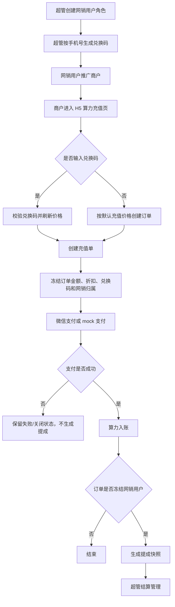
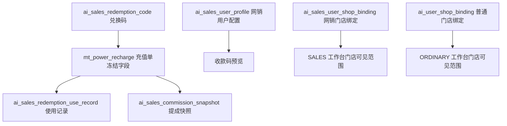

# 网销兑换码与提成结算产品需求文档

| 文档属性 | 内容 |
| --- | --- |
| 文档类型 | PRD / 产品需求文档 |
| 适用系统 | 商家 H5、PC 管理后台、后端算力充值与结算服务 |
| 当前状态 | 已按当前代码逻辑更新 |
| 最近更新 | 2026-04-26 |
| 核心模块 | 网销兑换码、充值优惠、订单归属冻结、提成结算、网销工作台 |

## 1. 背景与问题

美团商家侧小应用已经具备门店登录、算力充值、推广策略配置和管理后台门店管理能力。随着线下/网销获客链路启动，平台需要识别“哪位网销人员带来了哪笔充值”，并基于真实支付订单计算提成。

如果只在商家端增加一个兑换码输入框，无法解决三个关键问题：

- 归属不稳定：商户后续可能使用不同兑换码，历史订单归属不能被覆盖。
- 结算不可审计：提成必须来自已支付订单和冻结口径，不能依赖实时用户关系重算。
- 权限易串扰：普通用户和网销用户可能共用同一后台账号，菜单、接口、门店范围必须按当前工作台隔离。

因此，本需求落地的是一套完整的“按单兑换码归属 + 充值优惠 + 支付后提成快照 + 网销工作台”的业务闭环。

## 2. 产品目标

### 2.1 业务目标

| 目标 | 说明 |
| --- | --- |
| 支持网销获客归因 | 商户在充值时使用网销兑换码，系统记录本笔订单的网销归属 |
| 提升商户充值转化 | 对使用兑换码的充值流程提供更明确的优惠感知 |
| 支持财务结算 | 支付成功后自动生成可审计、可结算的提成快照 |
| 降低权限风险 | 普通工作台、网销工作台、管理员工作台在菜单、权限和数据上隔离 |

### 2.2 成功指标

| 指标 | 口径 |
| --- | --- |
| 兑换码启用率 | 已生成兑换码的网销用户数 / 网销用户总数 |
| 兑换码充值订单数 | 创建充值单时冻结了兑换码的订单数 |
| 兑换码充值实付金额 | 兑换码充值订单支付成功后的 `total_amount_fen` 汇总 |
| 提成快照生成成功率 | 成功生成提成快照的兑换码支付成功订单数 / 兑换码支付成功订单数 |
| 结算完成率 | `SETTLED` 提成快照数 / 全部提成快照数 |
| 收款码配置率 | 已上传收款码的网销用户数 / 已生成兑换码的网销用户数 |

## 3. 范围与非目标

### 3.1 本期范围

- 超管为网销用户生成唯一兑换码。
- 商户在 H5 算力充值页输入并应用兑换码，实时刷新本次充值价格。
- 创建充值单时冻结兑换码、网销用户、折扣口径和默认提成比例。
- 支付成功后按冻结数据生成提成快照，并保证重复支付通知不会重复生成。
- 超管查看兑换码、清空网销用户收款码、查看提成明细、修改未结算提成比例、标记已结算。
- 网销用户查看自己的兑换码、上传一次收款码、查看自己的提成明细。
- 网销工作台拥有独立门店绑定域和只读总控台。

### 3.2 非目标

| 非目标 | 说明 |
| --- | --- |
| 历史订单重算 | 已生成的充值订单和提成快照不因后续兑换码使用或收款码变化而重算 |
| 网销自动获得门店可见权 | 商户使用某网销兑换码后，不会自动把门店绑定到该网销用户 |
| 收款码多次自助替换 | 网销用户只能首次上传；如需替换，必须由超管清空后再上传 |
| 已结算提成重开 | 当前代码只允许标记为已结算，不支持把已结算记录重新打开 |
| 新增美团外呼 | 本需求不新增美团外部接口调用或回调入口 |

## 4. 术语定义

| 术语 | 定义 |
| --- | --- |
| 网销用户 | 后台角色为 `sales_user` 的用户，负责推广商户并获得充值提成 |
| 兑换码 | 超管为网销用户生成的 6 位大写字母和数字组合，一个网销用户最多一个 |
| 兑换码使用记录 | 商户创建充值单且该单使用兑换码时生成的按单使用记录 |
| 订单冻结 | 创建充值单时写入订单的兑换码、网销用户、折扣和默认提成比例，不随后续行为变化 |
| 提成快照 | 充值单支付成功后生成的结算记录，来源于充值单冻结数据 |
| 收款码 | 网销用户用于线下收款的图片，当前存储到对象存储并通过预览链接展示 |
| Portal / 工作台 | 后台账号当前激活的业务上下文，取值为 `ADMIN`、`ORDINARY`、`SALES` |

## 5. 角色与权限

| 角色 | 工作台 | 核心能力 | 明确限制 |
| --- | --- | --- | --- |
| 超级管理员 | `ADMIN` | 生成兑换码、查看全量兑换码、清空收款码、查看全量提成、修改未结算佣金比例、标记已结算 | 不能绕过已结算锁定修改佣金比例 |
| 网销用户 | `SALES` | 查看自己的兑换码、首次上传收款码、查看自己的提成、绑定自己的销售门店、只读查看总控台 | 不能生成兑换码、不能修改佣金比例、不能标记结算、不能自行删除收款码、不能编辑推广配置 |
| 普通用户 | `ORDINARY` | 普通门店绑定、普通总控台查看和编辑 | 不具备网销兑换码和提成结算能力 |
| 商户 | H5 | 查看算力、输入兑换码、创建充值单、完成支付 | 不进入 PC 管理后台，不参与结算管理 |

## 6. 端到端业务流程



## 7. 工作台与权限隔离

### 7.1 进入规则

| 登录场景 | 默认工作台 |
| --- | --- |
| 管理员账号登录 | `ADMIN` |
| 手机号登录且拥有网销角色 | `SALES` |
| 手机号登录且没有网销角色但拥有普通用户角色 | `ORDINARY` |
| 手机号登录并显式请求某工作台 | 必须校验该账号拥有对应工作台资格 |

### 7.2 隔离原则

- 后端为每个登录会话维护一个 `activePortal`。
- `current-user` 返回的菜单、权限和可用工作台由后端按 `activePortal` 过滤。
- `ORDINARY` 工作台只暴露 `shop:` 权限域。
- `SALES` 工作台只暴露 `sales:` 权限域。
- `ADMIN` 工作台保留管理员权限，并对共享路径去重，避免同一路由出现普通和网销两套重复菜单。
- 用户切换工作台时，后端必须校验该账号确实拥有目标工作台资格；未授权切换直接拒绝。

## 8. H5 算力充值与兑换码

### 8.1 页面入口

商户进入 H5 `算力` 页面后，可以查看：

- 当前算力余额、累计实充、实充已消耗。
- 首充优惠提示。
- 推荐充值档位、原价、折后价、优惠标签。
- 最近一笔充值单状态。
- 兑换码入口。

### 8.2 兑换码交互规则

| 规则 | 当前实现 |
| --- | --- |
| 是否必填 | 选填。不输入兑换码时，按默认充值价格创建订单，不产生网销提成 |
| 应用方式 | 商户输入兑换码后点击“应用”，H5 调用算力摘要接口并传入兑换码刷新价格 |
| 校验失败 | 展示兑换码校验失败，清空已应用兑换码，不改变默认价格 |
| 清空兑换码 | 商户点击“清空”后恢复默认价格摘要 |
| 下单传参 | 创建充值单时只提交已应用成功的兑换码 |
| 下单后状态 | 支付发起后，前端清空本地兑换码状态，下一次充值需重新应用 |

### 8.3 充值数量规则

| 项 | 当前默认配置 |
| --- | --- |
| 输入单位 | H5 输入“万算力”，提交给后端时换算为算力数 |
| 单价单位 | 每 `100000` 算力 `1` 元 |
| 最小充值 | `1000000` 算力 |
| 最大充值 | `1000000000` 算力 |
| 购买粒度 | 必须是 `100000` 算力的整数倍 |

### 8.4 价格与优惠规则

#### 8.4.1 未使用兑换码

| 场景 | 价格口径 |
| --- | --- |
| 首充资格内 | 使用系统配置的首充折扣梯度 |
| 非首充 | 使用系统配置的续充折扣梯度 |

当前默认续充折扣梯度：

| 算力区间 | 支付折扣 |
| --- | --- |
| `1000000` 到 `9990000` | 原价 |
| `10000000` 到 `49990000` | 9.5 折 |
| `50000000` 到 `99990000` | 8.5 折 |
| `100000000` 及以上 | 7 折 |

#### 8.4.2 使用有效兑换码

| 场景 | 价格口径 |
| --- | --- |
| 首充资格内 | 首充有效期在基础配置上额外延长 3 天，使用首充折扣梯度 |
| 非首充 | 使用兑换码专属续充折扣梯度 |

当前兑换码专属续充折扣梯度：

| 算力区间 | 支付折扣 |
| --- | --- |
| `1000000` 到 `9990000` | 原价 |
| `10000000` 到 `99990000` | 8 折 |
| `100000000` 及以上 | 7 折 |

### 8.5 下单冻结规则

创建充值单时，后端冻结以下字段：

| 冻结字段 | 说明 |
| --- | --- |
| 原价金额 | `original_amount_fen` |
| 折扣上下文 | `discount_context_type`，如 `REGULAR`、`FIRST_RECHARGE`、`REDEMPTION_REGULAR` |
| 展示标签 | `discount_tag` |
| 折扣比例 | `discount_rate_basis_points`，`10000` 表示原价 |
| 兑换码 ID | `redemption_code_id` |
| 兑换码 | `redemption_code` |
| 网销用户 | `sales_user_id`、`sales_user_phone` |
| 默认佣金窗口起点 | `commission_window_start_at` |
| 默认佣金比例 | `default_commission_ratio` |

冻结后，后续商户使用其他兑换码、网销门店绑定变化、收款码变化，都不得改变已创建订单的金额、归属和默认佣金比例。

## 9. 兑换码管理

### 9.1 超管兑换码管理页

入口：PC 管理后台 `兑换码`。

| 功能 | 说明 |
| --- | --- |
| 查询列表 | 支持按兑换码、网销手机号、用户名搜索 |
| 生成兑换码 | 输入 PC 端注册手机号，为网销用户生成兑换码 |
| 查看收款码 | 展示该网销用户当前收款码预览 |
| 清空收款码 | 清空后，该网销用户可重新上传一次 |

### 9.2 生成规则

| 规则 | 说明 |
| --- | --- |
| 操作权限 | 必须是超管，且拥有 `sales:redemption-code:create` |
| 手机号 | 按中国大陆手机号规范化和校验 |
| 用户资格 | 手机号必须对应后台用户，且该用户拥有 `ROLE_SALES` |
| 兑换码格式 | 6 位大写字母和数字 |
| 唯一性 | 兑换码全局唯一；一个网销用户最多一个兑换码 |
| 生成失败 | 手机号不存在、用户不是网销用户、用户已有兑换码时返回明确失败信息 |

### 9.3 兑换码状态

当前表结构预留 `status` 字段，现有业务只接受 `status = 1` 的兑换码。当前产品范围不提供禁用/启用兑换码的后台操作。

## 10. 网销配置与收款码

### 10.1 网销配置页

入口：PC 管理后台 `网销配置`，面向网销用户。

| 展示项 | 说明 |
| --- | --- |
| 网销用户 | 当前登录用户名称 |
| 手机号 | 当前登录用户手机号 |
| 兑换码 | 超管为该用户生成的兑换码；未生成时展示为空 |
| 当前收款码 | 已上传时展示预览；未上传时展示未上传 |

### 10.2 上传规则

| 规则 | 当前实现 |
| --- | --- |
| 文件类型 | 前端限制 PNG、JPG、WEBP |
| 文件大小 | 前端提示单张不超过 2MB |
| 存储方式 | 后端上传到对象存储，保存访问 URL、存储提供方和对象键 |
| 上传次数 | 网销用户仅允许首次上传 |
| 替换方式 | 需要超管在兑换码管理页清空后，网销用户才能再次上传 |
| 删除权限 | 网销用户不可自行删除；超管可清空 |

### 10.3 展示口径

提成明细和兑换码管理页展示的是网销用户“当前最新收款码”。收款码不冻结到订单或提成快照中，因此收款码变化只影响后续页面展示，不影响历史提成金额和归属。

## 11. 提成快照与结算

### 11.1 快照生成时机

当充值单支付成功时，后端执行：

1. 将充值单状态标记为支付成功。
2. 给门店算力账户入账。
3. 如果充值单冻结了 `sales_user_id`，生成提成快照。
4. 如果该充值单已存在提成快照，则直接跳过，保证幂等。

未使用兑换码的充值单不会生成提成快照。

### 11.2 快照字段

| 字段 | 说明 |
| --- | --- |
| 充值单 | `recharge_id`、`recharge_no` |
| 门店 | `shop_id`、`poi_id`、`shop_name`、`shop_phone` |
| 充值 | `power_amount`、`paid_amount_fen` |
| 提成 | `commission_ratio`、`commission_amount_fen` |
| 网销 | `sales_user_id`、`sales_user_phone` |
| 兑换码 | `redemption_code` |
| 状态 | `UNSETTLED`、`SETTLED` |
| 时间 | `paid_at` 来自充值单，`settled_at` 来自结算状态变更 |

### 11.3 默认佣金比例

默认佣金比例在创建充值单时冻结，不在支付成功时重新计算。

| 场景 | 默认比例 |
| --- | --- |
| 门店首次兑换码充值窗口起点后 90 天内 | 30% |
| 超过 90 天 | 15% |

窗口起点取该门店第一笔网销兑换码充值单的 `commission_window_start_at`；如果不存在历史网销充值单，则以当前下单时间作为窗口起点。

### 11.4 提成金额计算

```text
提成金额（分） = 实付金额（分） × 佣金比例 / 100
```

当前实现按四舍五入到整数分处理。

### 11.5 提成明细页

入口：PC 管理后台 `提成明细`。

| 能力 | 超管 | 网销用户 |
| --- | --- | --- |
| 查看列表 | 查看全部提成快照 | 仅查看自己的提成快照 |
| 筛选 | 商家名称/门店 ID/商家手机号、兑换码、充值订单号 | 同左，但结果仍限制为本人 |
| 查看收款码 | 展示网销用户当前收款码 | 展示自己的当前收款码 |
| 修改佣金比例 | 可修改未结算记录，范围 0 到 100 | 不可 |
| 标记已结算 | 可将未结算记录标记为已结算 | 不可 |
| 修改已结算记录 | 不可 | 不可 |

### 11.6 结算状态规则

| 状态 | 含义 | 可执行动作 |
| --- | --- | --- |
| `UNSETTLED` | 未结算 | 超管可改佣金比例、可标记已结算 |
| `SETTLED` | 已结算 | 不可改佣金比例，不可重新打开 |

## 12. 门店绑定与总控台

### 12.1 门店绑定域

普通用户绑定和网销用户绑定是两套独立业务关系。

| 场景 | 当前规则 |
| --- | --- |
| 普通用户已绑定某门店，网销用户再绑定该门店 | 允许 |
| 网销用户已绑定某门店，另一个网销用户再绑定该门店 | 不允许 |
| 同一网销用户重复绑定同一门店 | 不允许 |
| 商户使用某网销兑换码 | 不自动创建网销门店绑定 |

### 12.2 数据范围

- `ORDINARY` 工作台读取普通绑定表。
- `SALES` 工作台读取网销绑定表。
- `SELF` 范围只能查看当前用户绑定。
- `ALL` 范围可查看当前 portal 下所有绑定。
- 指定 `targetUserId` 时，必须位于当前用户可见用户范围内。

### 12.3 总控台权限

| 工作台 | 查看门店 | 查看推广配置 | 修改推广配置 | 查看推广日志 |
| --- | --- | --- | --- | --- |
| `ORDINARY` | 可 | 可 | 可 | 可 |
| `SALES` | 可 | 可 | 不可 | 可 |

网销工作台总控台定位为“销售视角只读看板”，用于查看已绑定门店的推广状态与日志，不承担运营配置入口。

## 13. 接口与页面清单

### 13.1 H5

| 页面/接口 | 说明 |
| --- | --- |
| `GET /api/h5/power/summary?redemptionCode=` | 获取算力摘要；传兑换码时按兑换码口径计算价格 |
| `POST /api/h5/power/recharges` | 创建充值单；参数包含 `powerAmount` 和可选 `redemptionCode` |
| `GET /api/h5/power/recharges/{rechargeNo}` | 查询充值结果 |
| `POST /api/h5/power/recharges/{rechargeNo}/mock-success` | mock 支付成功，仅测试环境开启 |

### 13.2 管理后台

| 页面 | 路由 | 核心权限 |
| --- | --- | --- |
| 兑换码 | `/sales/redemption-codes` | `sales:redemption-code:list`、`sales:redemption-code:create`、`sales:redemption-code:receipt-clear` |
| 网销配置 | `/sales/config` | `sales:self-config:view`、`sales:self-config:upload-receipt` |
| 提成明细 | `/sales/commissions` | `sales:commission:list`、`sales:commission:ratio-edit`、`sales:commission:settle` |
| 门店管理 | `/shops` | `shop:binding:*` 或 `sales:binding:*` |
| 总控台 | `/master-console` | `shop:master-console:*` 或 `sales:master-console:*` |

## 14. 数据模型



| 表/字段 | 产品含义 |
| --- | --- |
| `ai_sales_redemption_code` | 网销兑换码主表，约束兑换码唯一、网销用户唯一 |
| `ai_sales_redemption_use_record` | 按充值单记录兑换码成功使用历史 |
| `mt_power_recharge` 新增冻结字段 | 保存下单时兑换码、网销用户、折扣和默认佣金比例 |
| `ai_sales_commission_snapshot` | 支付成功后的提成结算快照 |
| `ai_sales_user_profile` | 网销用户收款码资料 |
| `ai_sales_user_shop_binding` | 网销工作台独立门店绑定关系 |

## 15. 关键异常与边界

| 场景 | 系统行为 |
| --- | --- |
| 输入空兑换码应用 | H5 提示请输入兑换码 |
| 输入无效或停用兑换码 | 后端返回兑换码无效，H5 不应用兑换码价格 |
| 手机号不存在 | 生成兑换码失败，提示手机号对应后台用户不存在 |
| 手机号对应用户不是网销 | 生成兑换码失败，提示该用户不是网销用户 |
| 网销用户已有兑换码 | 生成失败，避免一人多码 |
| 重复支付通知 | 已成功订单不重复入账，不重复生成提成快照 |
| 已有待支付首充订单 | 首充资格内不允许再次创建待支付首充订单 |
| 已上传收款码再次上传 | 拒绝，提示等待超管删除后才能重新上传 |
| 已结算记录改比例 | 拒绝 |
| 已结算记录重新打开 | 拒绝 |
| 网销尝试写推广配置 | 后端权限拒绝，配置保持不变 |

## 16. 验收标准

### 16.1 兑换码

- 超管输入有效网销手机号后，可以生成 6 位唯一兑换码。
- 非网销手机号、空手机号、格式错误手机号、已有兑换码用户均无法生成。
- 兑换码列表可按关键词查询，并展示网销用户、手机号、收款码状态和生成时间。
- 超管清空收款码后，网销用户配置页恢复可上传状态。

### 16.2 H5 充值

- 不输入兑换码可以正常查看价格、创建充值单和支付，不生成提成快照。
- 输入有效兑换码并应用后，价格摘要按兑换码口径刷新。
- 输入无效兑换码时，不允许将该兑换码带入下单。
- 创建充值单后，订单冻结兑换码、网销用户、折扣上下文和默认佣金比例。
- 同一商户后续使用其他兑换码，不影响已创建订单。

### 16.3 支付与提成

- 支付成功后，算力账户入账。
- 使用兑换码的支付成功订单生成一条提成快照。
- 重复查询或重复支付通知不生成重复快照。
- 超管可修改未结算记录佣金比例，提成金额同步重算。
- 超管可标记未结算记录为已结算，并写入结算时间。
- 已结算记录不可再修改比例或重新打开。
- 网销用户只能看到自己的提成记录。

### 16.4 Portal 与门店范围

- 手机号登录且拥有网销角色时默认进入 `SALES` 工作台。
- 双角色用户可在有权限的工作台之间切换。
- `SALES` 工作台只显示 `sales:` 权限菜单。
- `ORDINARY` 和 `SALES` 门店绑定互不污染。
- `SALES` 总控台可查看推广配置和日志，但不能提交配置修改。

## 17. 产品原则

1. 按单归属优先：兑换码只影响当前充值单，不形成商户长期归属。
2. 冻结口径优先：金额、优惠、网销归属和默认佣金比例以创建充值单时为准。
3. 结算快照不可重算：支付后的提成记录是财务结算依据，后续业务变化不得回写历史。
4. 后端权限优先：前端隐藏只是体验优化，真实权限必须由后端 `activePortal`、权限点和数据范围共同约束。
5. 门店可见与订单归属分离：网销门店绑定决定工作台能看哪些门店；兑换码决定某笔充值归属，两者不互相自动改写。
